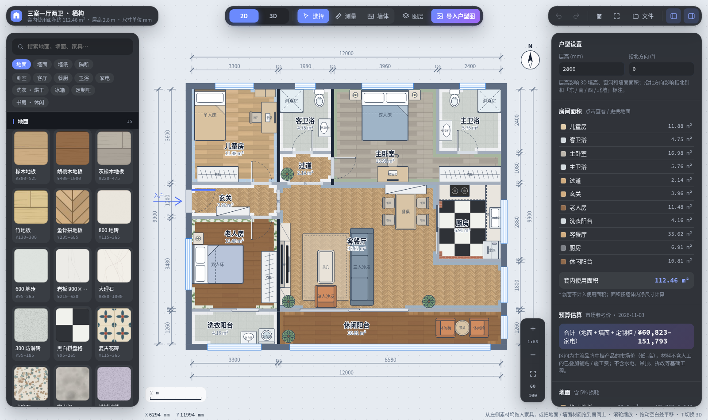
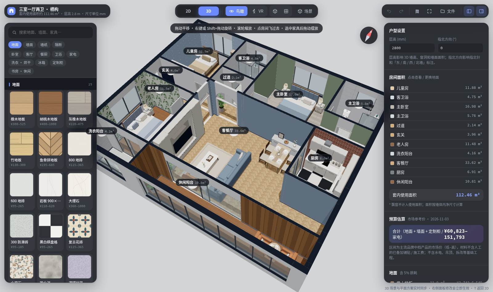
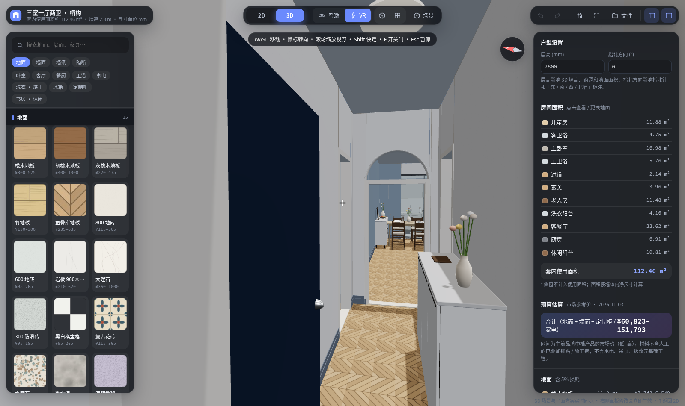
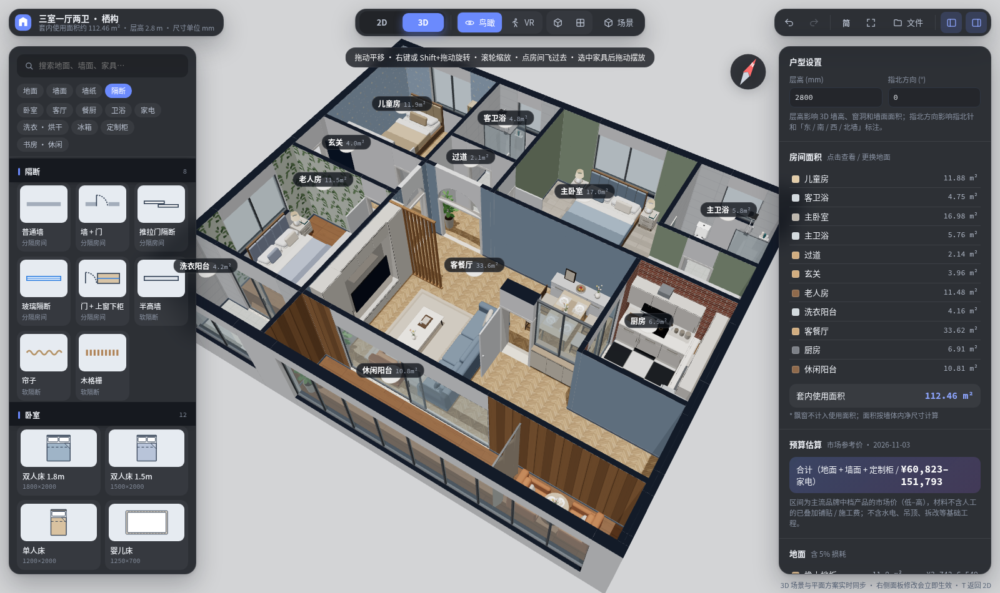
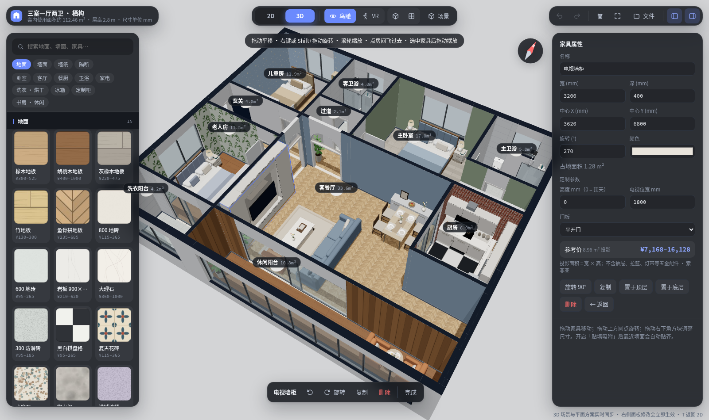
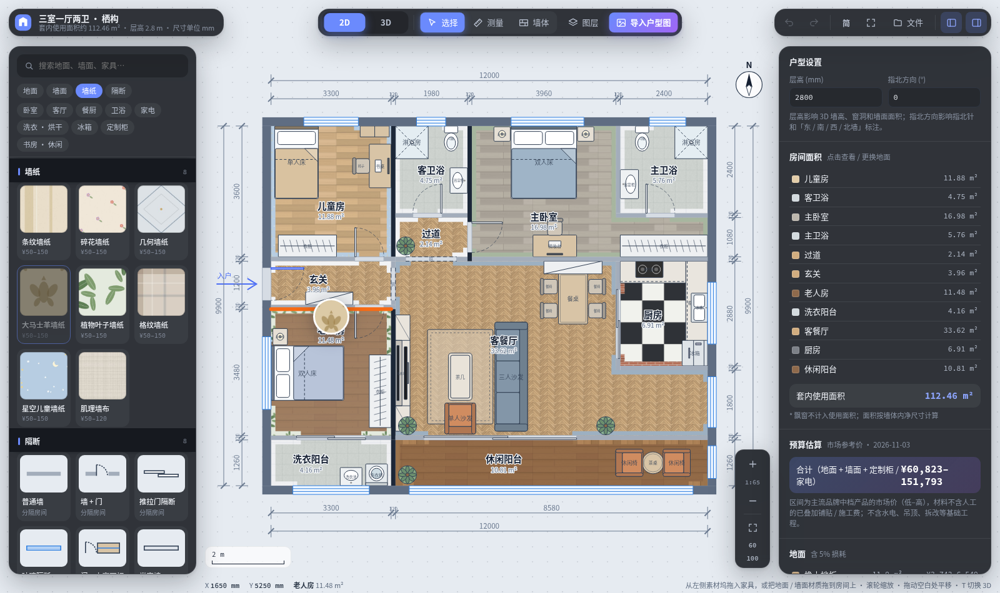
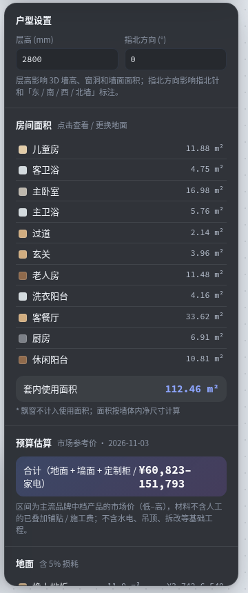
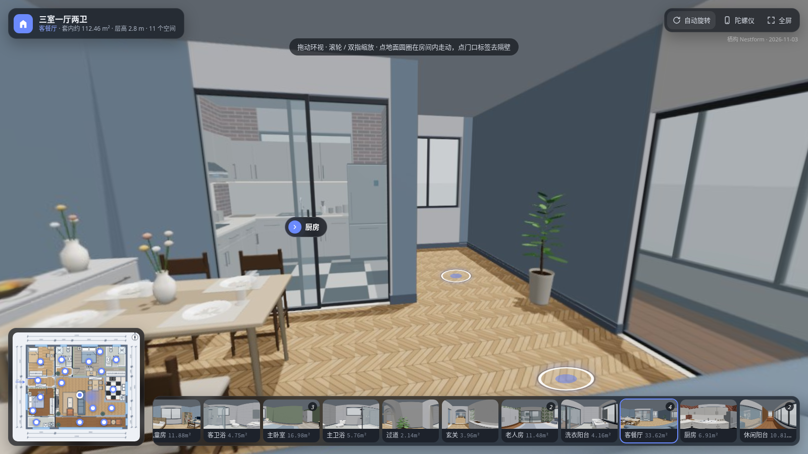

# 栖构 Nestform

> 「栖」是居所，「构」是结构与设计。从一张户型图，到一个能走进去看的家。

**栖构**是一款运行在浏览器里的户型与装修方案设计工具：
2D 平面编辑与 3D 场景实时同步，可以一键识别链家 / 贝壳 / 我爱我家的户型图，按市场参考价估算预算，
还能把方案导出成**可以发给任何人、双击就能打开的 VR 看房**。纯前端运行，图片和数据都不离开本机。



| 3D 鸟瞰 | VR 看房（应用内） |
|---|---|
|  |  |
| **隔断：单开门 + 上窗下柜 / 帘子 / 木格栅** | **定制柜：电视墙柜** |
|  |  |
| **墙纸拖到某一面墙，只刷这一面** | **预算：市场参考价区间** |
|  |  |

导出的 VR 看房（单个 HTML 文件，手机 / 电脑直接打开）：



## 快速开始

```bash
npm install
npm run dev       # 开发：http://localhost:5173
npm run build     # 产物在 dist/（纯静态文件，可放到任意静态目录）
npm run preview   # 预览构建产物
npm run lint      # ESLint
npm test          # 房间分割 / 弧形墙几何 / 户型图文字解析 / 命令行工具 单测
npm run nf -- help  # 命令行：自动画户型、摆家具、换材质（见下文「AI / 脚本自动操作」）
```

## 能做什么

### 画户型
- **一键导入户型图**：链家 / 贝壳 / 我爱我家等房源图，拖进画布或 Ctrl+V 粘贴，自动识别墙、门、窗、飘窗、房间；读出图中的房间名、面积和尺寸标注，用来命名房间、校准比例尺（也可两点测距或按套内面积手动校准）
- **墙体工具（W）**：拖墙、改长度、画新墙；开门洞（平开 / 拱形 / 推拉）、开窗；直墙一键变**弧形墙**；门窗沿墙拖动或数值微调
- **拆改**：标记拆除一整面墙，墙上的门窗一起拆，到 T 形交接处为止，承重墙 / 外墙不可拆，随时恢复
- **隔断**：普通墙、墙 + 门、推拉门、玻璃隔断、单开门 + 上窗下柜、半高墙、帘子、木格栅。在房间里拖一条线放置，实体隔断会把房间一分为二，删除隔断后房间自动合回；相邻且无墙的房间可「并入」合成一间
- **户型设置**：层高（影响 3D 墙高、窗洞、墙面面积与造价）、指北方向（2D 指北针、3D 随镜头转动的指北针、东南西北墙标注）

### 做装修
- **材质**：15 种地面（木地板、鱼骨拼、地砖、岩板、大理石、水磨石、微水泥、地毯…）；墙面乳胶漆 / 木饰面 / 墙砖 / 大理石 / 文化砖；8 种墙纸。2D 与 3D 共用同一套程序贴图
- **分面刷墙**：每面墙可单独选材质。把墙纸拖到墙边只刷这一面，拖到房间中间刷整间，3D 里也能拖
- **家具家电**：真实毫米尺寸，拖放 / 旋转 / 缩放 / 贴墙吸附。儿童床有上下铺（直梯）、梯柜高低床、子母床（拖床）、错层 L 型高低床、高架床（下方书桌）、滑梯城堡床、婴儿床。
- **灯具**：吸顶灯、客厅主灯、风扇灯、餐厅吊灯、筒灯、磁吸轨道灯、浴霸、床头吊灯、壁灯、镜前灯、台灯、落地灯、钓鱼灯。吊顶类自动挂到顶棚（VR 看房里显示，鸟瞰时隐藏不挡视线），台灯自动放到下方家具的台面上；夜景模式下灯会亮，房间里放了主灯就关掉自动生成的顶灯洗衣机有滚筒、波轮、洗烘一体、三筒分区、双子分区、洗烘叠放、烘干机等款式；冰箱有单门、上下双门、对开门、法式、十字四门、小冰箱、冰柜、酒柜等款式
- **定制柜（参数化）**：电视墙柜、洗衣机嵌入柜（1–2 机位 / 叠放 / 带水槽）、顶天衣柜、玄关柜、书柜墙、玻璃展示柜、吊柜。高度、离地、列数、层数、门板（平开 / 玻璃 / 开放格）都可调，2D 图例与 3D 模型随之变化
- **预算**：地面、墙面、墙纸、定制柜（按投影面积）、橱柜（按延米）、家电，全部按主流品牌中档产品的**市场参考价区间**估算；材料不含人工的自动叠加铺贴 / 施工费，检查器里列出每项来源（价目与口径见 `data/prices/SOURCES.md`）

### 看效果
- **3D 场景**：2D → 3D 过渡动画（墙体升起、家具立起）；拖动平移、右键旋转、滚轮缩放，手势与 2D 一致；点房间地面或房间名直接飞过去；全高 / 剖切、夜景灯光
- **在 3D 里编辑**：点墙 / 墙面 / 窗即可开洞、开窗、改弧形、拆除；拖家具到地面、拖材质到墙面；点门、推拉门、帘子开关
- **VR 看房（应用内）**：第一人称走进户型。WASD + 鼠标操作，触屏用虚拟摇杆；可滚轮 / 双指缩放视野；有墙体碰撞，关着的推拉门会挡路；阴角线、踢脚线、门套等细节让空间更有立体感

### 导出与分享
- **导出图片**：平面图导出为「方案展示图」，包含高清平面、房间图例（地面 / 墙面材质、面积）、套内面积与预算；3D 视角下导出为高清效果图，带房间标签与标题栏
- **导出 VR 看房**：每个房间按面积放 1–4 个点位，各拍一张 360° 全景，打包成**一个离线 HTML 文件**（无任何外部依赖），可以直接发给家人或设计师：
  - 拖动环视，滚轮 / 双指缩放；手机上可开陀螺仪
  - 点地面圆圈在房间里走动，点门口标签进入隔壁房间，切换带交叉淡入
  - 小地图实时显示所在位置与朝向，底部是房间缩略图
- **方案 JSON**：导出 / 导入完整方案；本地自动保存

### 其它
- 简体 / 繁體 / English
- 支持 iPad 等触屏手势；窄屏下素材面板与检查器变为抽屉
- PWA manifest，尊重 `prefers-reduced-motion`

## AI / 脚本自动操作

工程自带给 AI 编程助手用的操作说明（`skills/nestform/SKILL.md`：坐标约定、标准流程、检查清单、设计常识），以及两套自动化入口：

- **命令行** `npm run nf -- <命令>`（`tools/nf.mjs`）：直接读写方案 JSON，不需要浏览器。新建户型、画墙、开门窗、自动分房间并命名、摆家具、换材质，`info` 输出面积统计并检查出界 / 重叠 / 挡门：
  ```bash
  npm run nf -- new plans/a.json --size 9000x7000
  npm run nf -- wall plans/a.json --from 4500,0 --to 4500,3600
  npm run nf -- door plans/a.json --at 2200,3600
  npm run nf -- rooms plans/a.json --name 2000,1500=主卧 --name 6500,1500=次卧
  npm run nf -- furn plans/a.json --add bed --at 2250,1250
  npm run nf -- info plans/a.json
  ```
- **网页接口** `window.nestform`：`state` / `load()` / `edit(fn)` / `view('3d')` / `exportImage()` / `exportVR()` / `undo()` 等；网址加 `?plan=方案.json` 直接载入方案，便于浏览器自动化预览和出图。

## 界面

画布铺满全屏，所有控件都是浮在画布上的玻璃「浮岛」：

| 位置 | 内容 |
|---|---|
| 左上 | 方案名、套内面积 |
| 顶部中央 | 2D / 3D 切换与当前模式的工具。2D：选择 V、测量 M、墙体 W、图层、导入户型图；3D：鸟瞰 / VR、斜视 / 俯视、场景（墙高、家具、房间名、夜景） |
| 右上 | 撤销 / 重做、语言、全屏、文件菜单（导入 / 导出）、素材坞与检查器开关 |
| 左侧 | 素材坞：搜索 + 分类标签（与滚动联动）；地面、墙面、墙纸、隔断、家具家电。点击应用，或拖到房间 / 墙面 |
| 右侧 | 检查器：户型设置、面积与预算总览、房间（地面 + 逐面墙面）、家具（含定制柜参数）、墙 / 门 / 窗属性 |
| 右下 | 缩放：放大 / 比例 / 缩小 / 适应 / 1:60 / 1:100 |

## 户型图识别

全部在浏览器本地计算，图片不上传。

1. **墙体**（`src/import/recognize.js`）：用 Otsu 阈值加低色度过滤得到墙体候选。暗笔画游程统计估出外墙 / 内墙两档厚度，再按内墙厚度做形态学开运算，去掉文字、尺寸线和家具图例。之后横 / 竖拆分成轴对齐矩形（外墙上窗线和墙垛粘成的低填充长条只保留实心段），做同线对齐、墙角吸附和连通聚类（主体外框以内的组都保留，只丢框外的碎片）。
2. **门窗**：沿墙轴向寻找缺口，然后按特征分类：
   - ≥ 2 条平行细线 → 窗
   - 四分之一圆弧（含虚线弧）→ 门，并推断铰点与开向；两段错开的平行墙端头之间（门紧贴墙角）也会找门弧
   - 浅色实心填充 → 内墙
   - 外墙上无特征的缺口 → 窗
   - 短缺口 → 门洞
3. **房间**（`src/import/rooms.js`）：所有墙与门窗矩形的边切出非均匀网格，空单元格的连通分量构成直角多边形。另做一次像素级「室外」泛洪，用来封住斜角飘窗、虚线阳台等几何上封不住的地方。
4. **读图中文字**（`src/import/ocr.js`）：先在像素上找出文字行（深色、字号大小的连通块按行聚合，地板纹理、家具图例、门弧不会混进来），再逐行识别；数字再用只含数字的字符集认一遍。读出：
   - **房间名**（厨房、卫生间、卧室A…，含常见误读纠正）→ 直接用作房间名
   - **面积标注**（4.3㎡）→ 与正上方的房间名配成一对，用来校准比例尺、合并被误切开的碎片
   - **尺寸标注**（外圈的 3723、1682…）→ 相邻两个数字的间距给出独立的比例估计
   - 一间里读出两个房间名（如厨房和阳台挤在一起）→ 在两个名字之间找出漏掉的细隔墙，补上（长度只到这间房在这条线上的范围）
   - 文字行不跨墙合并（隔壁房间挨着的字不会粘成一行）；小房间里逐行没读到名字时（如储物间里笔画很细的单字「储」），把房间内部整块按单字再认一次
5. **比例尺**：多个来源互相印证 —— ≥3 间房的面积标注彼此一致时用面积标注；否则看面积标注与尺寸标注是否吻合；再退回门宽众数（住宅门 ≈ 850 mm）/ 外墙厚度。也可以两点测距或按套内面积手动校准。
6. **飘窗**：贴着外墙窗、向外凸出 0.35–1 m 的浅区域识别为飘窗（不计入使用面积，3D 中是窗台 + 三面玻璃）。
7. **清理**：比墙色明显浅、且至少一头悬空（不接深色墙也不接门窗）的「墙」视为家具描边（床、沙发、电视柜）并去掉，以它为端点的「门窗」一起去掉；没有窗线、两侧都是正常房间的「窗」改为开敞口（如过道接客厅）；与主墙体网络不相连、整组落在户型内的也去掉；宽度超过 1.3 m 的外墙「门」按窗处理。
8. **多层合图**：一张图里并排画了一层 / 二层 / 三层时，导入对话框会列出各层，选一层后只识别这一层。
9. **命名**：没读到文字的房间按面积、形状、填充颜色推测；入户门旁的小空间叫玄关。对话框里可直接改名。

## 许可

[MIT](LICENSE)
